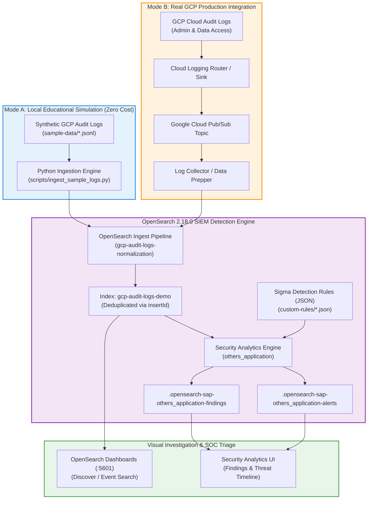

<div align="center">

# 🛡️ Threat Detection on GCP Audit Logs with OpenSearch Security Analytics

<p align="center">
  
</p>

[](https://opensearch.org/)
[](https://cloud.google.com/logging/docs/audit)
[](https://www.docker.com/captains/)
[](https://podman.io/)
[](https://www.python.org/)
[](tests/)
[](LICENSE)

---

### 🚀 Production-Grade • Student-Friendly • Zero Cloud Cost Required • 100% Reproducible

<p align="center">
  <a href="#3-learning-objectives--demonstration-mapping"><b>🎯 Learning Objectives</b></a> •
  <a href="#4-architecture"><b>🏗️ Architecture</b></a> •
  <a href="#8-quick-start-instructions"><b>⚡ Quick Start</b></a> •
  <a href="#18-student-hands-on-lab-exercises"><b>🧪 Lab Exercises</b></a> •
  <a href="#17-troubleshooting-matrix"><b>🔧 Troubleshooting</b></a> •
  <a href="#-lead-architect--technical-instructor"><b>👨‍🏫 Lead Architect & Instructor</b></a>
</p>

</div>

---

## 1. Project Overview

Cloud infrastructure security relies heavily on audit telemetry to detect unauthorized operations, privilege escalation, credential exfiltration, and defense evasion. However, raw cloud logs are voluminous, semi-structured, and vendor-specific.

This repository bridges theory and practice by providing a complete, working SIEM and threat detection implementation for GCP Cloud Audit Logs using **OpenSearch 2.18.0** and its native **Security Analytics** engine.

Students can practice detecting realistic attack scenarios locally without needing an active GCP account or incurring cloud expenses, while cloud engineers can refer to the documented architecture for real GCP Cloud Logging and Pub/Sub integrations.

---

## 2. Problem Statement

As organizations migrate to Google Cloud Platform, security perimeters shift from traditional IP firewalls to Identity and Access Management (IAM) and API control planes. Attackers with compromised credentials often bypass network perimeters entirely and perform malicious actions via standard GCP APIs:
* **Privilege Escalation**: Granting external users administrative roles (`SetIamPolicy`).
* **Credential Theft / Backdoor**: Creating user-managed service account private keys (`CreateServiceAccountKey`) to establish persistent out-of-band access.
* **Defense Evasion / Exposure**: Weakening firewall ingress rules (`firewalls.insert`) to expose internal workloads to the internet.
* **Probing / Reconnaissance**: Repeatedly polling restricted resources (`PERMISSION_DENIED`).
* **Log Tampering**: Deleting Cloud Logging export sinks (`DeleteSink`) to blind security teams and incident responders.

Without automated log collection, schema normalization, and continuous rule-based detection, these attacks remain unnoticed until catastrophic data exfiltration occurs.

---

## 3. Learning Objectives & Demonstration Mapping

| # | Learning Objective | How It Is Demonstrated in This Lab | Status |
| :-: | :--- | :--- | :-: |
| **1** | What GCP Cloud Audit Logs are and why they matter | Detailed in [docs/gcp-audit-logs.md](file:///c:/Users/cidco/Documents/OpenSearch%20+%20GCP%20Demo/docs/gcp-audit-logs.md) and explored practically in [Lab 01](file:///c:/Users/cidco/Documents/OpenSearch%20+%20GCP%20Demo/exercises/lab-01-explore-audit-logs.md). | 🟢 PASS |
| **2** | Differences between Admin Activity, Data Access, and System Events | Reflected in sample datasets (`normal-events.jsonl`, `suspicious-events.jsonl`) showing differences in `logName`, retention, and cost models. | 🟢 PASS |
| **3** | Identifying suspicious cloud operations from audit events | 5 simulated threat scenarios modeled in `sample-data/suspicious-events.jsonl` matching MITRE ATT&CK Cloud techniques. | 🟢 PASS |
| **4** | Collecting, parsing, normalizing, and indexing audit logs | Implemented in [scripts/ingest_sample_logs.py](file:///c:/Users/cidco/Documents/OpenSearch%20+%20GCP%20Demo/scripts/ingest_sample_logs.py) and [config/pipelines/log-normalization-pipeline.json](file:///c:/Users/cidco/Documents/OpenSearch%20+%20GCP%20Demo/config/pipelines/log-normalization-pipeline.json). | 🟢 PASS |
| **5** | How OpenSearch indexes and searches security events | Demonstrated via OpenSearch REST Query DSL, index mappings, and [Lab 02](file:///c:/Users/cidco/Documents/OpenSearch%20+%20GCP%20Demo/exercises/lab-02-ingest-events.md). | 🟢 PASS |
| **6** | Security Analytics detectors, Sigma rules, and findings | Automated in [scripts/configure_security_analytics.py](file:///c:/Users/cidco/Documents/OpenSearch%20+%20GCP%20Demo/scripts/configure_security_analytics.py) and documented in [docs/opensearch-security-analytics.md](file:///c:/Users/cidco/Documents/OpenSearch%20+%20GCP%20Demo/docs/opensearch-security-analytics.md). | 🟢 PASS |
| **7** | How to investigate a suspicious event | Hands-on runbook in [docs/investigation-guide.md](file:///c:/Users/cidco/Documents/OpenSearch%20+%20GCP%20Demo/docs/investigation-guide.md) and [Lab 04](file:///c:/Users/cidco/Documents/OpenSearch%20+%20GCP%20Demo/exercises/lab-04-investigate-findings.md). | 🟢 PASS |
| **8** | Distinguishing a security alert from a confirmed incident | Dedicated section in [docs/investigation-guide.md](file:///c:/Users/cidco/Documents/OpenSearch%20+%20GCP%20Demo/docs/investigation-guide.md) covering triage methodology and alert fatigue reduction. | 🟢 PASS |
| **9** | Troubleshooting ingestion, mapping, and detector failures | Diagnostic matrix with commands and fixes in [docs/troubleshooting.md](file:///c:/Users/cidco/Documents/OpenSearch%20+%20GCP%20Demo/docs/troubleshooting.md). | 🟢 PASS |
| **10**| Reproducing the lab and cleaning up resources safely | Automated via `make cleanup`, `make verify`, and documented in [docs/cleanup.md](file:///c:/Users/cidco/Documents/OpenSearch%20+%20GCP%20Demo/docs/cleanup.md). | 🟢 PASS |

---

## 4. Architecture



For complete architectural details, see [docs/architecture.md](file:///c:/Users/cidco/Documents/OpenSearch%20+%20GCP%20Demo/docs/architecture.md).

---

## 5. Technology Stack

* **SIEM & Search Core**: [OpenSearch 2.18.0](https://opensearch.org/)
* **Visualization & Analytics**: OpenSearch Dashboards 2.18.0
* **Detection Engine**: OpenSearch Security Analytics Plugin (Sigma specification)
* **Container Runtime**: [Podman](https://podman.io/) (preferred) or [Docker](https://www.docker.com/)
* **Orchestration**: `podman-compose` / `docker compose`
* **Telemetry Normalization**: Python 3.11+ / OpenSearch Ingest Pipelines
* **Testing Framework**: `pytest`

---

## 6. Prerequisites

* **Hardware**: Minimum 4 GB RAM (8 GB+ recommended), 2 CPU cores, 10 GB free disk space.
* **Operating System**: Linux (Ubuntu/Debian, Fedora, RHEL), macOS (Apple Silicon / Intel), or Windows 10/11 with WSL2.
* **Kernel Limit**: `vm.max_map_count >= 262144` (required by OpenSearch).
* **Tools**: Podman/Docker, Python 3.9+, curl, GNU Make.

See [docs/prerequisites.md](file:///c:/Users/cidco/Documents/OpenSearch%20+%20GCP%20Demo/docs/prerequisites.md) for verification commands.

---

## 7. Repository Structure

```text
threat-detection-gcp-opensearch/
├── README.md                                 # Master documentation and laboratory guide
├── LICENSE                                   # Apache 2.0 Open Source License
├── CONTRIBUTING.md                            # Contributor guidelines and rule addition workflow
├── SECURITY.md                               # Security policy, defensive mandate, hardening tips
├── .gitignore                                # Exclusions for secrets, containers, and caches
├── .env.example                              # Environment configuration template
├── Makefile                                  # Automation targets (setup, start, ingest, test)
├── compose.yaml                              # Podman/Docker compose stack definition
├── docs/                                     # Comprehensive architectural and operational guides
│   ├── architecture.md                       # Design, data flow, Mode A vs Mode B
│   ├── prerequisites.md                      # System requirements and environment verification
│   ├── setup-guide.md                        # Step-by-step setup walkthrough
│   ├── gcp-audit-logs.md                     # Deep dive into GCP audit log taxonomy and schemas
│   ├── opensearch-security-analytics.md      # Detectors, rules, findings, and REST API guide
│   ├── detection-rules.md                    # Threat scenarios, MITRE ATT&CK mapping, triage
│   ├── investigation-guide.md                # Incident response runbooks and triage workflows
│   ├── troubleshooting.md                    # Diagnostic matrix and recovery playbooks
│   ├── cleanup.md                            # Safe local and cloud resource teardown
│   ├── lab-exercises.md                      # Curriculum overview for hands-on exercises
│   └── instructor-guide.md                   # Lecture plan, 5-min demo, assessment questions
├── config/                                   # Cluster configurations and mappings
│   ├── opensearch/opensearch.yml             # Single-node educational OpenSearch settings
│   ├── dashboards/opensearch_dashboards.yml  # Dashboards UI settings
│   ├── pipelines/                            # Ingest Pipeline JSON definition
│   │   └── log-normalization-pipeline.json
│   └── mappings/                             # Index mapping schema
│       └── gcp-audit-logs-mapping.json
├── scripts/                                  # Operational automation scripts
│   ├── setup.sh                              # Validates environment and tools
│   ├── start.sh                              # Starts containers and monitors cluster health
│   ├── health-check.sh                       # Diagnostic health checker
│   ├── generate-sample-logs.py               # Generates synthetic normal and threat events
│   ├── ingest_sample_logs.py                 # Ingestion engine with idempotency & normalization
│   ├── ingest-sample-logs.sh                 # Shell wrapper for ingestion
│   ├── configure_security_analytics.py       # Configures rules, mappings, and detectors
│   ├── configure-security-analytics.sh       # Shell wrapper for detector configuration
│   ├── run_detection_tests.py                # Validates threat scenarios and findings
│   ├── run-detection-tests.sh                # Shell wrapper for detection tests
│   ├── verify-demo.sh                        # Full end-to-end verification suite
│   └── cleanup.sh                            # Safe container and volume teardown
├── sample-data/                              # Synthetic GCP audit log datasets
│   ├── normal-events.jsonl                   # 7 routine benign operational events
│   ├── suspicious-events.jsonl               # 9 simulated malicious events (5 scenarios)
│   └── README.md                             # Dataset documentation and synthetic data notice
├── detection-rules/                          # Custom Sigma rules
│   ├── README.md                             # Rules overview and schema guide
│   └── custom-rules/                         # Custom Sigma JSON rules
│       ├── gcp_iam_binding_changed.json
│       ├── gcp_service_account_key_created.json
│       ├── gcp_firewall_rule_exposed.json
│       ├── gcp_excessive_denied_api_calls.json
│       └── gcp_logging_sink_deleted.json
├── tests/                                    # Automated pytest test suite
│   ├── test_log_parser.py                    # Unit tests for log parsing & malformed JSON
│   ├── test_normalization.py                 # Schema mapping & taxonomy unit tests
│   └── test_detection_scenarios.py           # Unit rules validation & live cluster tests
└── exercises/                                # Progressive student hands-on labs
    ├── lab-01-explore-audit-logs.md          # Lab 01: Audit log categories & schema
    ├── lab-02-ingest-events.md               # Lab 02: Pipeline normalization & indexing
    ├── lab-03-detect-iam-changes.md          # Lab 03: Security Analytics detectors & rules
    ├── lab-04-investigate-findings.md        # Lab 04: Incident investigation & containment
    └── lab-05-create-custom-detection.md     # Lab 05: Build & test a new custom Sigma rule
```

---

## 8. Quick-Start Instructions

You can start the lab in two ways:

### Option A: Interactive Animated Launcher (Recommended for Beginners & Classroom)
Run the self-bootstrapping, zero-prerequisite quickstart script:

```bash
./quickstart.sh
# Or via Make:
make quickstart
```

* 🚀 **Zero prerequisites**: Detects your Linux distribution and automatically installs Python, cURL, or Podman if missing.
* 🎨 **Interactive & Animated**: Prompts for your preferred mode (Local Simulation or Real GCP), project ID, and ports with rich 256-color animations and progress spinners.
* ⚡ **Runs Everything End-to-End**: Bootstraps containers, ingests telemetry, activates threat detectors, and runs detection tests automatically!

---

### Option B: Step-by-Step Make Workflow (Recommended for Advanced Students & CI)
Follow this validated sequence from the repository root:

```bash
# 1. Clone repository
git clone <repository-url> threat-detection-gcp-opensearch
cd threat-detection-gcp-opensearch

# 2. Initialize configuration
cp .env.example .env

# 3. Setup environment and dependencies
make setup

# 4. Start OpenSearch lab cluster
make start

# 5. Ingest and normalize audit logs
make ingest

# 6. Activate detection rules and detector
make configure-detectors

# 7. Run automated verification
make verify
```

---

## 9. Podman Installation and Startup

Podman is the preferred container runtime for this lab as it offers daemonless, rootless container management.

### Installation

* **Ubuntu / Debian**:
  ```bash
  sudo apt-get update && sudo apt-get install -y podman podman-compose
  ```
* **macOS (Homebrew)**:
  ```bash
  brew install podman podman-compose
  podman machine init --cpus 2 --memory 4096
  podman machine start
  ```
* **Windows (WSL2)**:
  Inside your Ubuntu WSL2 terminal, install `podman` and `podman-compose` via `apt-get`. Ensure `vm.max_map_count` is set:
  ```bash
  sudo sysctl -w vm.max_map_count=262144
  ```

### Startup Command
```bash
podman-compose up -d
# Or use the make shortcut:
make start
```

---

## 10. OpenSearch Access Instructions

Once the containers are running:

* **OpenSearch REST API**: [http://localhost:9200](http://localhost:9200)
  * Verify health: `curl -s http://localhost:9200/_cluster/health`
* **OpenSearch Dashboards UI**: [http://localhost:5601](http://localhost:5601)
  * Access via your web browser to explore logs, visualize timelines, and triage findings.

---

## 11. Sample Event Generation and Ingestion

The repository includes a standalone data generator (`scripts/generate-sample-logs.py`) that produces realistic, timestamp-current synthetic GCP audit logs:

```bash
# Generate sample logs
make generate-logs

# Ingest and normalize into OpenSearch
make ingest
```

### Ingestion Features:
* **Schema Validation**: Malformed JSON lines are flagged without aborting the batch.
* **Normalization**: Maps `protoPayload.methodName` to `gcp.method_name` and `event.action`.
* **Idempotency**: Uses `insertId` as the document `_id` to guarantee duplicate-safe re-runs.

---

## 12. Security Analytics Configuration

OpenSearch Security Analytics evaluates logs against the Sigma specification:

```bash
make configure-detectors
```

This automates:
1. Configuring field mappings linking GCP audit attributes to the rule schema.
2. Uploading 5 custom Sigma detection rules into `_plugins/_security_analytics/rules`.
3. Creating the `gcp-threat-detector` detector monitoring `gcp-audit-logs-demo` on a 1-minute schedule.

---

## 13. Detection Verification

Run automated detection testing:

```bash
# Run scenario tests
make test

# Or run full verification suite
make verify
```

The test runner validates that all 5 threat scenarios are identified in the telemetry:
* `[PASS]` IAM Role Binding Modification (`SetIamPolicy` - MITRE T1098)
* `[PASS]` Service Account Key Creation (`CreateServiceAccountKey` - MITRE T1098.001)
* `[PASS]` Firewall Ingress Opened to Internet (`firewalls.insert` - MITRE T1562.007)
* `[PASS]` Repeated Permission Denied Attempts (`code: 7` - MITRE T1087.004)
* `[PASS]` Cloud Logging Sink Deletion (`DeleteSink` - MITRE T1562.008)

---

## 14. Example Searches and Findings

### Query 1: Find All Actions by External Principals
```bash
curl -s -X POST "http://localhost:9200/gcp-audit-logs-demo/_search" \
    -H "Content-Type: application/json" \
    -d '{
      "query": {
        "wildcard": { "gcp.principal": "*external-mail*" }
      }
    }' | python3 -m json.tool
```

### Query 2: Search for Security Analytics Findings
```bash
curl -s -X POST "http://localhost:9200/_plugins/_security_analytics/findings/_search" \
    -H "Content-Type: application/json" \
    -d '{"query": {"match_all": {}}}' | python3 -m json.tool
```

---

## 15. Real GCP Integration (Mode B)

For enterprise deployments monitoring live Google Cloud environments:

1. **Create Pub/Sub Topic**:
   ```bash
   gcloud pubsub topics create gcp-audit-logs-topic --project=[PROJECT_ID]
   ```
2. **Create Cloud Logging Sink**:
   ```bash
   gcloud logging sinks create siem-audit-sink \
       pubsub.googleapis.com/projects/[PROJECT_ID]/topics/gcp-audit-logs-topic \
       --log-filter='logName:"cloudaudit.googleapis.com"' \
       --project=[PROJECT_ID]
   ```
3. **Grant Publisher Role**: Grant `roles/pubsub.publisher` to the sink's writer service account.
4. **Deploy Collector**: Use [OpenSearch Data Prepper](https://opensearch.org/docs/latest/data-prepper/) with the `google_cloud_pubsub` source plugin to ingest messages directly into OpenSearch over mutual TLS.

For complete IAM, credential handling, and cost considerations, see [docs/architecture.md](file:///c:/Users/cidco/Documents/OpenSearch%20+%20GCP%20Demo/docs/architecture.md).

---

## 16. Security Considerations

* **Local Learning Mode**: `plugins.security.disabled=true` is used in `compose.yaml` to minimize setup barriers for beginners.
* **Production Hardening**: Production environments MUST enable mutual TLS, strong RBAC, VPC private endpoints, and KMS encryption. Never expose OpenSearch port 9200 to the public internet.
* **Secrets Policy**: Never commit `.env` files, service account JSON keys, or passwords.

See [SECURITY.md](file:///c:/Users/cidco/Documents/OpenSearch%20+%20GCP%20Demo/SECURITY.md) for full policy details.

---

## 17. Troubleshooting Matrix

| Symptom | Cause | Diagnostic Command | Quick Fix |
| :--- | :--- | :--- | :--- |
| **`vm.max_map_count low`** | Kernel limit < 262144 | `sysctl vm.max_map_count` | `sudo sysctl -w vm.max_map_count=262144` |
| **WSL2 container exit 143** | WSL idle timeout | `dmesg \| grep shutdown` | Run persistent session: `sleep infinity &` |
| **Port 9200 refused** | Container still booting | `podman logs opensearch-node` | Wait 30s and check `make health-check` |
| **0 documents indexed** | Mapping created before pipeline | `curl localhost:9200/gcp-audit-logs-demo/_count` | Run `make clean-data && make ingest` |

See [docs/troubleshooting.md](file:///c:/Users/cidco/Documents/OpenSearch%20+%20GCP%20Demo/docs/troubleshooting.md) for the complete troubleshooting guide.

---

## 18. Student Hands-On Lab Exercises

Follow the five progressive laboratory exercises:

1. [Lab 01: Explore Cloud Audit Logs](file:///c:/Users/cidco/Documents/OpenSearch%20+%20GCP%20Demo/exercises/lab-01-explore-audit-logs.md)
2. [Lab 02: Ingest and Normalize Events](file:///c:/Users/cidco/Documents/OpenSearch%20+%20GCP%20Demo/exercises/lab-02-ingest-events.md)
3. [Lab 03: Detect IAM Privilege Escalation](file:///c:/Users/cidco/Documents/OpenSearch%20+%20GCP%20Demo/exercises/lab-03-detect-iam-changes.md)
4. [Lab 04: Investigate Findings & Formulate Remediation](file:///c:/Users/cidco/Documents/OpenSearch%20+%20GCP%20Demo/exercises/lab-04-investigate-findings.md)
5. [Lab 05: Build a Custom Detection Rule](file:///c:/Users/cidco/Documents/OpenSearch%20+%20GCP%20Demo/exercises/lab-05-create-custom-detection.md)

---

## 19. Cleanup & Reset Instructions

To stop containers and delete stored volumes:

```bash
make cleanup
```

To reset only the ingested index without stopping containers:
```bash
make clean-data
```

See [docs/cleanup.md](file:///c:/Users/cidco/Documents/OpenSearch%20+%20GCP%20Demo/docs/cleanup.md) for real GCP resource teardown.

---

## 20. Estimated Resource Requirements

* **Local Simulation (Mode A)**:
  * RAM: ~1.5 GB memory utilized during execution.
  * CPU: < 10% average utilization on dual-core machine.
  * Disk: ~1.2 GB container images + 50 MB data storage.
  * Cost: **$0.00 (100% Free)**.
* **Real GCP Integration (Mode B)**:
  * Admin Activity Logs: Free.
  * Pub/Sub: Free tier covers 10 GB/month.
  * Data Access Logs (if enabled): ~$0.50/GB after 50 GB free allocation.

---

## 21. Known Limitations

1. **Security Analytics Scheduled Evaluation**: OpenSearch Security Analytics detectors run on a scheduled interval (minimum 1 minute). Findings are not instantaneous upon document indexing.
2. **Local Security Plugin Disabled**: Designed exclusively for local classroom simulation; must not be used in internet-exposed environments without enabling the OpenSearch security plugin.

---

## 22. Further Learning Resources

* [OpenSearch Security Analytics Documentation](https://opensearch.org/docs/latest/security-analytics/)
* [Google Cloud Audit Logs Overview](https://cloud.google.com/logging/docs/audit)
* [Sigma Rule Specification](https://github.com/SigmaHQ/sigma)
* [MITRE ATT&CK Framework for Cloud](https://attack.mitre.org/matrices/enterprise/cloud/)
* [Ashutosh Bhakare's GitHub Repositories](https://github.com/ashutoshbhakare)

---

## 👨‍🏫 Lead Architect & Technical Instructor

<div align="center">

| **Ashutosh S. Bhakare** |
| :---: |
| **Docker Captain** • **Google Developer Expert (GDE)** • **Cloud & DevSecOps Architect** |
| Founder & CEO, *Unnati Development and Training Centre Pvt. Ltd.* |
| [](https://github.com/ashutoshbhakare) [](https://www.linkedin.com/) [](https://www.docker.com/captains/) [](mailto:bhakareashutosh@yahoo.com) |

</div>

**Ashutosh S. Bhakare** is an internationally recognized technology leader, open-source champion, and enterprise educator with over two decades of experience empowering engineering teams across Cloud Native, Linux, Kubernetes, Google Cloud, and Container Security.

As an official **Docker Captain** and **Google Developer Expert (GDE)**, Ashutosh has trained thousands of software engineers, architects, and university students globally, championing hands-on, practical learning over pure theory. This laboratory was designed to provide students and security professionals with a zero-barrier, production-grade sandbox for mastering cloud threat detection.

