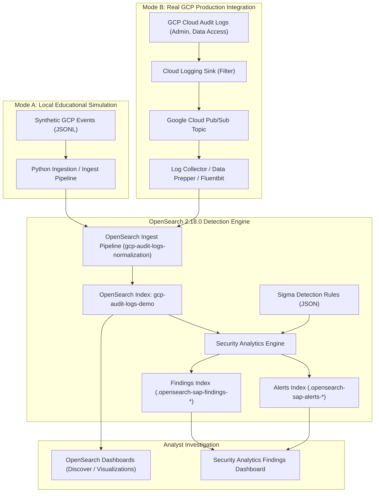

# Architecture: Threat Detection on GCP Audit Logs with OpenSearch Security Analytics

This document details the architectural design, component interactions, data pipelines, and operational modes of the GCP Cloud Audit Log threat detection lab.

---

## 1. High-Level Architecture Overview

Modern cloud environments produce voluminous, high-velocity telemetry across thousands of API operations per second. Detecting sophisticated threats—such as unauthorized privilege escalation, stealthy credential generation, and log tampering—requires a robust, scalable security analytics pipeline that ingests, normalizes, detects, and provides an investigation interface for security operations centers (SOC) and DevSecOps teams.

---

## 2. Operational Modes

To accommodate diverse training environments, this repository supports two distinct operational modes:

### Mode A: Local Learning Mode (Default)
* **Goal**: Provide a 100% self-contained, reproducible training experience without requiring a paid Google Cloud account, active billing, or cloud IAM permissions.
* **Mechanism**: Realistic, deterministic synthetic GCP Cloud Audit Logs are loaded from `sample-data/` via local Python scripts and OpenSearch Ingest Pipelines into containerized OpenSearch 2.18.0 managed by Podman.
* **Safety**: Synthetic logs use RFC 5737 documentation IP ranges (`198.51.100.0/24`) and fictitious project names (`demo-student-project`). No live cloud resources are modified.

### Mode B: Real GCP Production Integration (Optional Extension)
* **Goal**: Connect a live Google Cloud Platform environment to OpenSearch for enterprise security monitoring.
* **Mechanism**: 
  1. Audit logs are collected natively by GCP Cloud Logging.
  2. A Logging Sink routes filtered audit events to a Cloud Pub/Sub topic.
  3. A collector agent (such as OpenSearch Data Prepper, Logstash, or Fluent Bit) pulls messages from Pub/Sub, unpacks the `protoPayload`, applies the normalization schema, and indexes into OpenSearch via HTTPS with TLS mutual authentication.
* **Documentation**: See [docs/setup-guide.md](file:///c:/Users/cidco/Documents/OpenSearch%20+%20GCP%20Demo/docs/setup-guide.md) and [docs/gcp-audit-logs.md](file:///c:/Users/cidco/Documents/OpenSearch%20+%20GCP%20Demo/docs/gcp-audit-logs.md) for step-by-step setup and IAM least-privilege configurations.

---

## 3. Data Pipeline & Normalization

GCP Cloud Audit Logs represent audit events in the Protocol Buffer JSON format (`google.cloud.audit.AuditLog`). While comprehensive, native GCP fields must be normalized so that security detection rules written in the open-source Sigma standard can evaluate events efficiently.

### Schema Transformation

| Raw GCP Audit Field | Normalized Common Schema | OpenSearch Field Alias | Purpose |
| :--- | :--- | :--- | :--- |
| `timestamp` | `@timestamp` | `@timestamp` | Event chronological ordering |
| `protoPayload.methodName` | `event.action` | `gcp.method_name` | API operation executed |
| `protoPayload.serviceName` | `service.name` | `gcp.service_name` | Target GCP service |
| `protoPayload.authenticationInfo.principalEmail` | `user.name`, `actor.user` | `gcp.principal` | Identity performing the action |
| `protoPayload.requestMetadata.callerIp` | `source.ip` | `gcp.caller_ip` | Originating client network address |
| `protoPayload.resourceName` | `resource.name` | `gcp.resource_name` | GCP resource targeted |
| `protoPayload.status.code` | `event.outcome` | `gcp.status_code` | 0 = success, >0 = failure (e.g. 7 = PERMISSION_DENIED) |
| `severity` | `log.level` | `severity` | GCP event priority (INFO, NOTICE, WARNING, ERROR) |

### Ingestion Strategy
1. **Preservation**: The original `protoPayload`, `resource`, and metadata objects are preserved intact. Security analysts conducting deep forensics retain complete access to parameters (such as `serviceData.policyDelta`).
2. **Idempotency**: GCP audit logs include a globally unique `insertId`. Ingestion scripts use `insertId` as the OpenSearch document `_id`. Re-ingesting a log batch updates existing documents in place rather than creating duplicates.

---

## 4. OpenSearch Security Analytics Architecture

OpenSearch Security Analytics is a native plugin that evaluates logs against detection rules using the Sigma specification.

### Core Components
1. **Log Types**: Represents the schema category of telemetry. We utilize `others_application` (built-in across all OpenSearch 2.x releases) and provide field alias mappings linking GCP audit attributes to rule parameters.
2. **Sigma Rules**: Detection logic defined in YAML or JSON. Each rule specifies:
   - Target log category (`others_application`)
   - Detection criteria (exact match, wildcards, boolean logic)
   - Severity level (`low`, `medium`, `high`, `critical`)
   - MITRE ATT&CK taxonomy tags
3. **Detectors**: A detector attaches a set of detection rules to an active OpenSearch index pattern (e.g., `gcp-audit-logs-*`). Detectors run on a configurable schedule (1 minute in this lab) to query newly indexed documents.
4. **Findings vs Alerts**:
   - **Finding**: Generated whenever an indexed document satisfies a detection rule condition. Findings represent evidence of interest and do not immediately interrupt on-call staff.
   - **Alert**: Generated when a finding triggers a configured alert condition (e.g., critical severity threshold reached). Alerts trigger notifications to Slack, PagerDuty, email, or webhooks.

---

## 5. Security & Production Hardening

### Local Educational Configuration
In this lab's `compose.yaml`:
- `plugins.security.disabled=true` is used to allow beginners to interact directly with REST APIs without TLS certificate generation and HTTP Basic Authentication hurdles.
- OpenSearch binds to `0.0.0.0:9200` locally.

### Production Security Architecture
In an enterprise deployment, the security architecture must be hardened:
1. **Security Plugin Enabled**: `plugins.security.disabled=false` with strong TLS certificates for node-to-node (port 9300) and REST (port 9200) traffic.
2. **Role-Based Access Control (RBAC)**: Map SOC analysts to read-only roles on audit indices and findings; restrict detector modification to Security Engineers.
3. **Network Isolation**: Deploy OpenSearch in a private VPC subnet with no public IP. Ingress must traverse an authenticated reverse proxy, private load balancer, or bastion.
4. **Encryption at Rest**: Enable AWS KMS or GCP Cloud KMS-managed customer-managed encryption keys (CMEK) on underlying persistent storage volumes.
