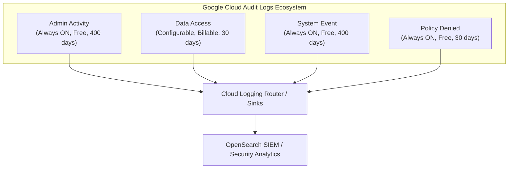

# Google Cloud Platform (GCP) Cloud Audit Logs Guide

Understanding Cloud Audit Logs is foundational to detecting cloud intrusions, investigating security breaches, and maintaining regulatory compliance in Google Cloud Platform.

This guide explains the architecture, categories, schema structure, and security implications of GCP Cloud Audit Logs.

---

## 1. What Are Cloud Audit Logs?

Google Cloud Audit Logs provide a tamper-evident audit trail answering:
* **Who** initiated the operation? (`protoPayload.authenticationInfo.principalEmail`)
* **What** API method was called? (`protoPayload.methodName`)
* **Where** was the action performed? (`protoPayload.resourceName`, `resource.labels`)
* **When** did it occur? (`timestamp`)
* **What was the outcome?** (`protoPayload.status.code`, `protoPayload.status.message`)
* **From where?** (`protoPayload.requestMetadata.callerIp`, `callerSuppliedUserAgent`)

---

## 2. The Four Audit Log Categories

GCP classifies audit events into four distinct streams:



### 1. Admin Activity Logs
* **Log Name**: `projects/[PROJECT_ID]/logs/cloudaudit.googleapis.com%2Factivity`
* **What It Records**: Entries for API calls or administrative actions that modify the configuration or metadata of resources (e.g., creating a Compute Engine instance, updating firewall rules, modifying IAM policies, deleting storage buckets).
* **Default State**: **Always enabled**. Cannot be turned off.
* **Retention**: **400 days** at no additional cost.
* **Security Importance**: Primary telemetry for detecting unauthorized infrastructure modifications, privilege escalation, and persistence.

### 2. Data Access Logs
* **Log Name**: `projects/[PROJECT_ID]/logs/cloudaudit.googleapis.com%2Fdata_access`
* **What It Records**:
  - **Admin Read**: Operations that inspect resource configuration (e.g., `ListInstances`, `GetIamPolicy`).
  - **Data Read**: Operations that read user-provided data (e.g., downloading an object from Cloud Storage, executing a BigQuery `SELECT`).
  - **Data Write**: Operations that write or alter user-provided data (e.g., uploading a file to Cloud Storage).
* **Default State**: **Disabled by default** (except for BigQuery) due to massive potential volume and associated cost.
* **Retention**: **30 days** by default (can be extended). Billable based on ingestion volume.
* **Security Importance**: Essential for detecting unauthorized data exfiltration, secret theft from Secret Manager, or insider data snooping.

### 3. System Event Logs
* **Log Name**: `projects/[PROJECT_ID]/logs/cloudaudit.googleapis.com%2Fsystem_event`
* **What It Records**: Administrative actions performed by automated Google systems rather than human users or service accounts (e.g., live VM migration, automated OS patch management).
* **Default State**: **Always enabled**.
* **Retention**: **400 days** at no additional cost.

### 4. Policy Denied Logs
* **Log Name**: `projects/[PROJECT_ID]/logs/cloudaudit.googleapis.com%2Fpolicy`
* **What It Records**: Security events generated when access is denied by organization policies or VPC Service Controls.
* **Default State**: **Always enabled**.
* **Retention**: **30 days**.

---

## 3. GCP Audit Log Anatomy

Every audit log entry contains a standardized Google Protobuf envelope (`google.cloud.audit.AuditLog`):

```json
{
  "insertId": "1g8f9a2b3c4d",
  "logName": "projects/demo-student-project/logs/cloudaudit.googleapis.com%2Factivity",
  "resource": {
    "type": "project",
    "labels": {
      "project_id": "demo-student-project",
      "location": "us-central1"
    }
  },
  "timestamp": "2026-10-16T12:00:00Z",
  "severity": "NOTICE",
  "protoPayload": {
    "@type": "type.googleapis.com/google.cloud.audit.AuditLog",
    "serviceName": "iam.googleapis.com",
    "methodName": "SetIamPolicy",
    "resourceName": "projects/demo-student-project",
    "authenticationInfo": {
      "principalEmail": "compromised-admin@demo-corp.internal",
      "callerIp": "198.51.100.45",
      "callerSuppliedUserAgent": "google-cloud-sdk/460.0.0"
    },
    "requestMetadata": {
      "callerIp": "198.51.100.45",
      "callerNetwork": "network-external"
    },
    "status": {
      "code": 0,
      "message": ""
    },
    "serviceData": {
      "policyDelta": {
        "bindingDeltas": [
          {
            "action": "ADD",
            "role": "roles/owner",
            "member": "user:attacker-exfil@external-mail.example"
          }
        ]
      }
    }
  }
}
```

### Critical Fields to Scrutinize During Triage

1. **`insertId`**: Globally unique identifier for the event. Used for deduplication and correlating multiple log sinks.
2. **`protoPayload.methodName`**: The specific RPC method invoked (e.g., `SetIamPolicy`, `CreateServiceAccountKey`).
3. **`protoPayload.authenticationInfo.principalEmail`**: The user account, service account, or Google identity that invoked the API.
4. **`protoPayload.requestMetadata.callerIp`**: Public or private IP of the client. Look for unexpected foreign IP ranges, Tor exit nodes, or residential VPNs.
5. **`protoPayload.status.code`**: Google RPC status code:
   - `0`: `OK` (operation succeeded)
   - `7`: `PERMISSION_DENIED` (unauthorized attempt)
   - `3`: `INVALID_ARGUMENT`
   - `5`: `NOT_FOUND`
6. **`protoPayload.serviceData`**: Method-specific payload details (e.g., IAM binding deltas showing exactly what role was granted to whom).

---

## 4. Enabling Data Access Logs in Real GCP Environments

To collect Data Access logs for critical services (e.g., Secret Manager, Cloud Storage, Compute Engine), you must enable them in the GCP Console or via Terraform:

```hcl
# Example Terraform configuration to enable Data Access logging
resource "google_project_iam_audit_config" "audit_config" {
  project = var.gcp_project_id
  service = "allServices"

  audit_log_config {
    log_type = "ADMIN_READ"
  }
  audit_log_config {
    log_type = "DATA_READ"
  }
  audit_log_config {
    log_type = "DATA_WRITE"
  }
}
```

> [!TIP]
> **Cost Optimization**: Enabling `DATA_READ` on high-throughput Cloud Storage buckets can generate terabytes of logs per day. Focus Data Access logging on sensitive resources such as Secret Manager, KMS, and sensitive customer buckets.
