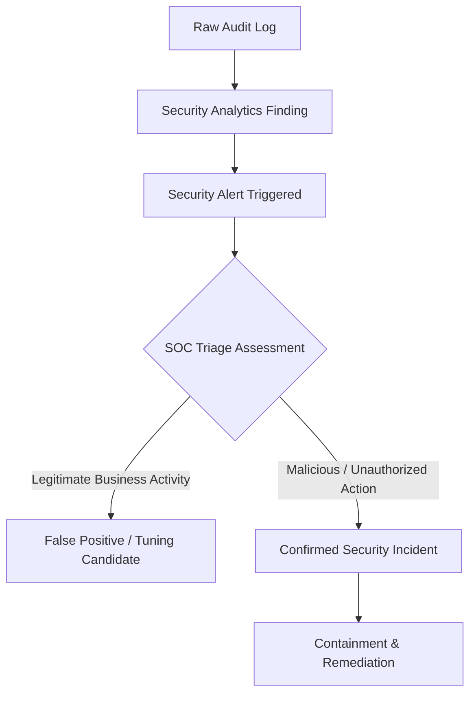

# Incident Investigation Guide: GCP Cloud Audit Logs

This runbook guides security analysts and students through investigating, triaging, and responding to suspicious activities detected in GCP Cloud Audit Logs using OpenSearch.

---

## 1. Alert vs Incident: Triage Philosophy

In security operations, confusing alerts with confirmed incidents causes alert fatigue and misallocated resources:



* **Alert**: An automated notification that a condition occurred (e.g., `SetIamPolicy` was invoked). An alert is a *hypothesis* of malicious activity.
* **Confirmed Incident**: An event verified by a human analyst to violate organizational policy, compromise confidentiality, integrity, or availability, or represent unauthorized access.

### The Four Key Triage Questions
1. **Who?** Is `protoPayload.authenticationInfo.principalEmail` an authorized employee, automated deployment service account, or untrusted external user?
2. **From Where?** Does `protoPayload.requestMetadata.callerIp` match approved corporate offices, corporate VPN gateways, or an unfamiliar external IP/Tor/VPN?
3. **Why?** Is there a corresponding approved Change Management ticket or JIRA issue for this action?
4. **What Changed?** Did the action grant excessive privileges (`roles/owner`), expose ports (`0.0.0.0/0:22`), or delete monitoring infrastructure (`DeleteSink`)?

---

## 2. Investigation Runbook: 5-Step Methodology

### Step 1: Examine the Finding in OpenSearch Security Analytics
1. Open **OpenSearch Dashboards** (`http://localhost:5601`).
2. Navigate to **OpenSearch Plugins > Security Analytics > Findings**.
3. Locate the finding ID and review:
   - **Rule Name** and **Severity** (e.g., `GCP IAM Role Binding Modification`, `Critical`).
   - **Triggering Document ID** (`insertId`).
   - **Timestamp**.

### Step 2: Retrieve the Full Event Telemetry
Use OpenSearch **Dev Tools** or **Discover** to pull the complete event document:

```json
GET gcp-audit-logs-demo/_doc/sim-threat-001-iam-escalation
```

Inspect the nested fields under `protoPayload`:
* `protoPayload.methodName`
* `protoPayload.serviceData.policyDelta`
* `protoPayload.authenticationInfo`
* `protoPayload.requestMetadata`

### Step 3: Pivot and Reconstruct Timeline
Search for all actions initiated by the suspicious principal 2 hours before and after the event:

```json
POST gcp-audit-logs-demo/_search
{
  "query": {
    "bool": {
      "must": [
        { "term": { "gcp.principal": "compromised-admin@demo-corp.internal" } }
      ]
    }
  },
  "sort": [
    { "@timestamp": { "order": "asc" } }
  ]
}
```

### Step 4: Pivot by Source IP
Check if other credentials were used from the same suspicious IP address:

```json
POST gcp-audit-logs-demo/_search
{
  "query": {
    "term": { "gcp.caller_ip": "198.51.100.45" }
  }
}
```

---

## 3. Threat-Specific Containment Playbooks

### Playbook A: Unauthorized IAM Role Binding (`SetIamPolicy`)
1. **Scope**: Review `serviceData.policyDelta.bindingDeltas`. Identify the unauthorized identity.
2. **Contain**: Remove the unauthorized binding immediately:
   ```bash
   gcloud projects remove-iam-policy-binding demo-student-project \
       --member="user:attacker-exfil@external-mail.example" \
       --role="roles/owner"
   ```
3. **Isolate**: If the actor account is an employee, suspend the account or reset credentials in Google Workspace / Cloud Identity.
4. **Audit**: Review all resources accessed by the attacker during the window of elevated privilege.

### Playbook B: Rogue Service Account Key Creation
1. **Identify**: Find the target service account and Key ID from `protoPayload.resourceName`.
2. **Revoke**: Immediately destroy the compromised key:
   ```bash
   gcloud iam service-accounts keys delete [KEY_ID] \
       --iam-account="data-exporter@demo-student-project.iam.gserviceaccount.com"
   ```
3. **Audit**: Review Cloud Audit Logs filtered by `principalEmail: data-exporter@...` to verify if the key was already used to exfiltrate data.

### Playbook C: Exposed Firewall Ingress Rule
1. **Identify**: Rule name from `protoPayload.request.name` or `protoPayload.resourceName`.
2. **Remediate**: Delete or restrict the firewall rule to trusted CIDRs:
   ```bash
   gcloud compute firewall-rules delete allow-all-ssh-world
   ```
3. **Inspect**: Check VPC Flow Logs on target instances for unauthorized inbound SSH connections.

### Playbook D: Deleted Cloud Logging Sink
1. **Severity**: **CRITICAL** (SIEM Visibility Blinded).
2. **Restore**: Re-create the export sink to resume audit streaming:
   ```bash
   gcloud logging sinks create siem-opensearch-export-sink \
       pubsub.googleapis.com/projects/demo-student-project/topics/gcp-audit-logs-topic \
       --log-filter='logName:"cloudaudit.googleapis.com"'
   ```
3. **Investigate**: Assume adversary is actively performing destructive actions while logging was disrupted.
