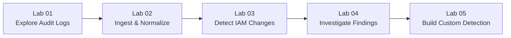

# Hands-On Lab Exercises Overview

This curriculum contains five progressive, hands-on lab exercises designed to take a student from cloud audit log fundamentals to advanced threat detection engineering and incident triage.

---

## Lab Curriculum Overview

### [Lab 01: Explore Cloud Audit Logs](file:///c:/Users/cidco/Documents/OpenSearch%20+%20GCP%20Demo/exercises/lab-01-explore-audit-logs.md)
* **Focus**: Deconstructing GCP Cloud Audit Logs.
* **Concepts**: Admin Activity vs Data Access, Google Protobuf schema, identifying caller identity, method, IP, and status.
* **Time**: 20 minutes.

### [Lab 02: Ingest and Normalize Events](file:///c:/Users/cidco/Documents/OpenSearch%20+%20GCP%20Demo/exercises/lab-02-ingest-events.md)
* **Focus**: Ingestion pipelines, OpenSearch index mappings, and idempotent bulk indexing.
* **Concepts**: Ingest pipelines, field transformation, deduplication using `insertId`.
* **Time**: 25 minutes.

### [Lab 03: Detect IAM Privilege Escalation](file:///c:/Users/cidco/Documents/OpenSearch%20+%20GCP%20Demo/exercises/lab-03-detect-iam-changes.md)
* **Focus**: OpenSearch Security Analytics configuration.
* **Concepts**: Sigma detection rules, detectors, log types, field alias mappings.
* **Time**: 30 minutes.

### [Lab 04: Investigate Security Findings](file:///c:/Users/cidco/Documents/OpenSearch%20+%20GCP%20Demo/exercises/lab-04-investigate-findings.md)
* **Focus**: Incident triage and forensic timeline reconstruction.
* **Concepts**: Distinguishing alerts from incidents, pivoting on `principalEmail` and `callerIp`, evaluating policy deltas, remediation commands.
* **Time**: 35 minutes.

### [Lab 05: Build a Custom Detection Rule](file:///c:/Users/cidco/Documents/OpenSearch%20+%20GCP%20Demo/exercises/lab-05-create-custom-detection.md)
* **Focus**: Detection engineering for emerging cloud threats.
* **Concepts**: Authoring Sigma JSON rules for Cloud Storage public exposure, testing rule against synthetic attack events, tuning false positives.
* **Time**: 40 minutes.

---

## Pedagogical Structure of Each Lab

Every exercise includes:
1. **Objective**: Concrete technical skills gained.
2. **Prerequisites**: Required files or completed prior labs.
3. **Core Concepts**: Background theory explained simply.
4. **Step-by-Step Instructions**: Copy-pasteable commands with realistic terminal output.
5. **Verification Steps**: How to confirm the step succeeded.
6. **Common Mistakes & Troubleshooting**: Gotchas and fixes.
7. **Discussion Questions**: Review questions for classroom discussion.
8. **Challenge Task**: Independent exercise with progressive hints before the solution.
