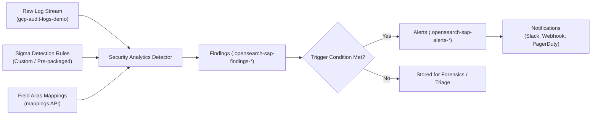

# OpenSearch Security Analytics: Concepts and Operational Guide

OpenSearch Security Analytics is a security information and event management (SIEM) subsystem built directly into OpenSearch. It enables detection engineers and SOC analysts to automatically evaluate high-velocity log data against threat detection rules, surface suspicious findings, and generate actionable security alerts.

---

## 1. Core Architectural Concepts



### 1.1 Log Types
A **Log Type** defines the security schema and taxonomy of incoming logs. OpenSearch provides built-in log types for common platforms (e.g., `windows`, `linux`, `cloudtrail`, `s3`, `network`, `dns`, `others_application`).
* For GCP Cloud Audit Logs, we utilize the flexible `others_application` log type (or custom log types created via `POST /_plugins/_security_analytics/logtype`).
* Field alias mappings bridge the raw GCP fields (e.g., `protoPayload.methodName`) to the normalized fields evaluated by detection rules.

### 1.2 Sigma Rules
OpenSearch Security Analytics natively supports detection rules defined using the open-source **Sigma rule format**.
* Rules describe threat patterns in a vendor-neutral schema.
* OpenSearch compiles these rules into real-time Lucene queries executed against indexed documents.

### 1.3 Detectors
A **Detector** is a scheduled job that links:
1. Target data sources (indices or data streams like `gcp-audit-logs-*`).
2. A collection of detection rules (custom or pre-packaged).
3. An evaluation schedule (e.g., every 1 minute).
4. Optional alert triggers and notification destinations.

### 1.4 Findings vs Alerts: Critical Distinction

Understanding the difference between a finding and an alert is crucial for operational security:

| Characteristic | Security Finding | Security Alert |
| :--- | :--- | :--- |
| **Definition** | Evidence that a specific log entry matched a detection rule | Actionable notification indicating that a security threshold or condition was met |
| **Storage Index** | `.opensearch-sap-findings-*` | `.opensearch-sap-alerts-*` |
| **Analyst Impact** | Passive record used during threat hunting and incident correlation | Active notification delivered to on-call engineers via Slack/PagerDuty |
| **Operational Goal** | Maximize context and detection fidelity | Minimize alert fatigue; reserve for high-confidence incidents |

---

## 2. Security Analytics REST API Reference

### 2.1 Rule APIs

#### Create a Custom Rule
```http
POST /_plugins/_security_analytics/rules?category=others_application
Content-Type: application/json

{
  "title": "GCP IAM Role Binding Modification",
  "id": "a1b2c3d4-e5f6-4a1b-8c2d-3e4f5a6b7c81",
  "description": "Detects SetIamPolicy changes",
  "status": "experimental",
  "author": "SecOps",
  "date": "2026/10/16",
  "tags": ["attack.t1098"],
  "logsource": {
    "product": "others_application",
    "service": "gcp_audit"
  },
  "detection": {
    "selection": {
      "gcp.method_name": "SetIamPolicy"
    },
    "condition": "selection"
  },
  "level": "critical"
}
```

#### Search Rules
```http
POST /_plugins/_security_analytics/rules/_search?category=others_application
Content-Type: application/json

{
  "query": { "match_all": {} }
}
```

---

### 2.2 Field Mappings API

To ensure detection rules match incoming documents, field alias mappings are submitted:

```http
POST /_plugins/_security_analytics/mappings
Content-Type: application/json

{
  "index_name": "gcp-audit-logs-demo",
  "rule_topic": "others_application",
  "partial": true,
  "alias_mappings": {
    "properties": {
      "gcp.method_name": {
        "type": "alias",
        "path": "protoPayload.methodName"
      },
      "gcp.principal": {
        "type": "alias",
        "path": "protoPayload.authenticationInfo.principalEmail"
      }
    }
  }
}
```

---

### 2.3 Detector APIs

#### Create a Detector
```http
POST /_plugins/_security_analytics/detectors
Content-Type: application/json

{
  "name": "gcp-threat-detector",
  "detector_type": "others_application",
  "enabled": true,
  "schedule": {
    "period": { "interval": 1, "unit": "MINUTES" }
  },
  "inputs": [
    {
      "detector_input": {
        "description": "GCP Threat Detector",
        "indices": ["gcp-audit-logs-demo"],
        "custom_rules": [
          { "id": "a1b2c3d4-e5f6-4a1b-8c2d-3e4f5a6b7c81" }
        ]
      }
    }
  ],
  "triggers": [
    {
      "name": "critical-findings-trigger",
      "severity": "1",
      "types": ["others_application"],
      "actions": []
    }
  ]
}
```

---

### 2.4 Findings & Alerts Query APIs

#### Search Findings
```http
POST /_plugins/_security_analytics/findings/_search
Content-Type: application/json

{
  "query": { "match_all": {} },
  "size": 20
}
```

#### Search Alerts
```http
POST /_plugins/_security_analytics/alerts/_search
Content-Type: application/json

{
  "query": { "match_all": {} }
}
```
